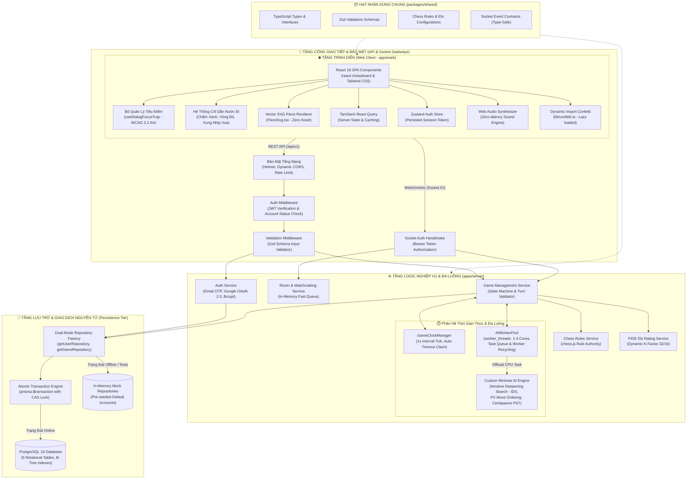
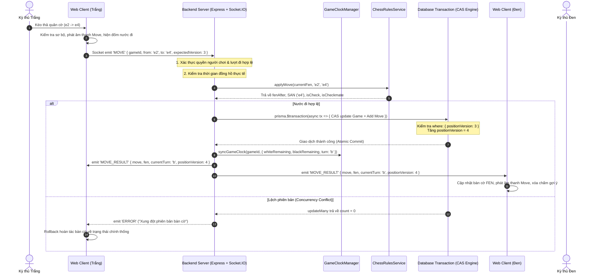
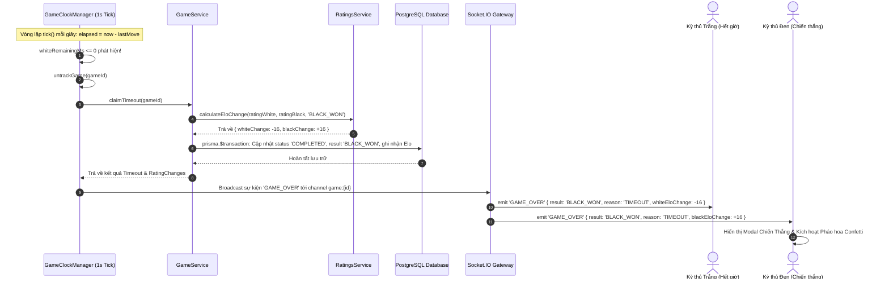
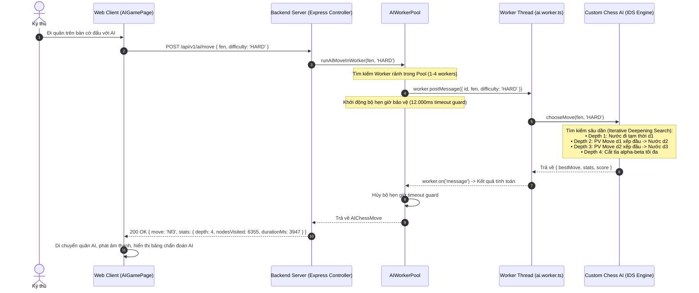
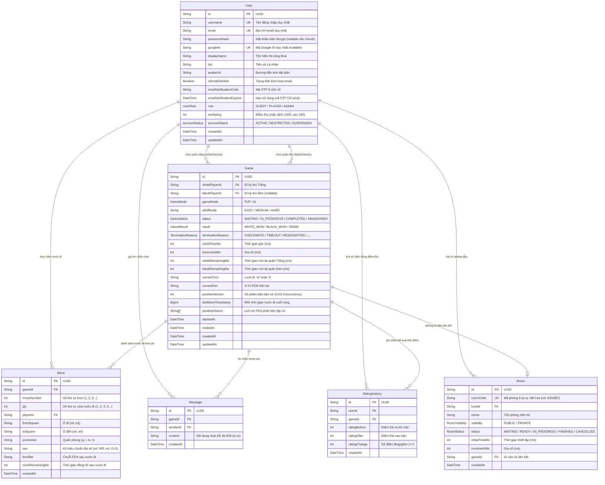

# ♟️ BÁO CÁO VÀ PHÂN TÍCH TOÀN DIỆN DỰ ÁN ONLINE CHESS PLATFORM
### Nền Tảng Cờ Vua Trực Tuyến Thời Gian Thực, Máy Chủ Thẩm Quyền, Động Cơ AI Minimax Đa Luồng (Worker Threads & Iterative Deepening), Đồng Hồ Thẩm Quyền Phân Tán & Tối Ưu Hóa Giao Diện Đạt Chuẩn WCAG 2.2 AA

> [!NOTE]
> **Tài liệu Báo cáo Kỹ thuật & Phân tích Hệ thống (Bản Cập Nhật Sau Cải Tiến Toàn Diện)**  
> **Ngôn ngữ triển khai**: TypeScript Full-stack (React 18 + Node.js/Express + PostgreSQL 16)  
> **Đơn vị thực hiện**: Đồ án Chuyên ngành / Khóa luận Tốt nghiệp Kỹ thuật Phần mềm & Khoa học Máy tính  
> **Kiến trúc hệ thống**: Monorepo (`npm workspaces`), Đa luồng (`worker_threads`), Server-Authoritative Engine  
> **Tình trạng kiểm thử**: **75/75 passing tests (100%)** trên 10 bộ kiểm thử tự động (Vitest + Supertest)

---

## 📑 MỤC LỤC CHI TIẾT

1. [TỔNG QUAN DỰ ÁN & CÁC CẢI TIẾN TRỌNG TÂM (PROJECT OVERVIEW & RECENT UPGRADES)](#1-tổng-quan-dự-án--các-cải-tiến-trọng-tâm-project-overview--recent-upgrades)
   - 1.1. Giới thiệu & Bối cảnh đề tài
   - 1.2. Tổng hợp các cải tiến kỹ thuật đột phá mới nhất
   - 1.3. Bảng chỉ số kỹ thuật sau nâng cấp (Key Engineering Metrics)
2. [KIẾN TRÚC TỔNG THỂ HỆ THỐNG ĐÃ CẢI TIẾN (ENHANCED SYSTEM ARCHITECTURE)](#2-kiến-trúc-tổng-thể-hệ-thống-đã-cải-tiến-enhanced-system-architecture)
   - 2.1. Mô hình phân tầng kiến trúc mở rộng (Multi-tier Architecture)
   - 2.2. Sơ đồ khối kiến trúc hệ thống sau cải tiến (Enhanced Architecture Diagram)
   - 2.3. Nguyên lý Máy chủ Thẩm quyền tuyệt đối (Server-Authoritative Paradigm)
   - 2.4. Phân lập tính toán AI bằng Worker Threads (`AIWorkerPool`)
   - 2.5. Cơ chế Đồng hồ Thẩm quyền Phân tán (`GameClockManager`)
   - 2.6. Khóa lạc quan cấp Cơ sở Dữ liệu & Giao dịch Nguyên tử (CAS & Prisma Transactions)
   - 2.7. Mẫu thiết kế Dual-Mode Repository phục hồi cao (High Fault Tolerance)
3. [PHÂN TÍCH CHI TIẾT CÔNG NGHỆ SỬ DỤNG (TECHNOLOGY STACK & TRADE-OFFS)](#3-phân-tích-chi-tiết-công-nghệ-sử-dụng-technology-stack--trade-offs)
   - 3.1. Bảng ma trận công nghệ hệ thống toàn diện
   - 3.2. Phân tích Frontend Stack & Tối ưu hóa Bundle (Vite Code Splitting)
   - 3.3. Phân tích Backend Stack & Xử lý đa luồng (Worker Threads)
   - 3.4. Phân tích Tầng Lưu trữ & Giao dịch Toàn vẹn (PostgreSQL & Prisma)
   - 3.5. Gói hạt nhân chia sẻ trung tâm `@online-chess/shared`
   - 3.6. Kỹ thuật tổng hợp âm thanh bàn cờ Web Audio API (0ms delay)
4. [CẤU TRÚC DỰ ÁN & TỔ CHỨC MÃ NGUỒN HIỆN TẠI (MONOREPO STRUCTURE)](#4-cấu-trúc-dự-án--tổ-chức-mã-nguồn-hiện-tại-monorepo-structure)
   - 4.1. Cấu trúc cây thư mục tổng thể Monorepo
   - 4.2. Chi tiết gói Dùng chung (`packages/shared`)
   - 4.3. Chi tiết máy chủ Backend (`apps/server`)
   - 4.4. Chi tiết ứng dụng Web Client (`apps/web`)
5. [CÁC THUẬT TOÁN TRIỂN KHAI & CẢI TIẾN HIỆU NĂNG (ALGORITHMS & COMPUTATIONAL LOGIC)](#5-các-thuật-toán-triển-khai--cải-tiến-hiệu-năng-algorithms--computational-logic)
   - 5.1. Động cơ cờ vua tùy chỉnh nâng cấp (Custom Minimax + Alpha-Beta + IDS)
     - 5.1.1. Giải thuật Tìm kiếm Sâu dần (Iterative Deepening Search - IDS)
     - 5.1.2. Tối ưu hóa thứ tự nước đi nâng cao (Principal Variation - PV Move & MVV-LVA)
     - 5.1.3. Hàm đánh giá tĩnh vị thế bàn cờ Heuristic (Centipawns Evaluation)
     - 5.1.4. Cơ chế Time Guard & Ngắt an toàn phân phối ngân sách
     - 5.1.5. Bộ điều phối Worker Pool & Phòng thủ giật lùi (Resilient Fallback)
     - 5.1.6. Ba cấp độ thông minh của AI
   - 5.2. Thuật toán Quản lý Đồng hồ Thẩm quyền & Nội suy mượt mà
     - 5.2.1. Vòng lặp đếm nhịp máy chủ 1 giây & Tự động kết thúc ván do Hết giờ
     - 5.2.2. Thuật toán bù trừ độ trễ mạng & Nội suy mượt mà phía Client
   - 5.3. Thuật toán tính điểm Elo chuẩn FIDE (`ratings.service.ts`)
   - 5.4. Thuật toán ghép trận tự động (Matchmaking Queue)
   - 5.5. Thuật toán tái tạo lịch sử ván cờ (Step-by-Step Replay Reconstruction)
   - 5.6. Thuật toán định vị Vua bị chiếu & Hiệu ứng trực quan (`findKingSquare`)
6. [ĐẶC TẢ CÁC USE CASE & PHÂN CẤP TÁC NHÂN (USE CASE SPECIFICATIONS)](#6-đặc-tả-các-use-case--phân-cấp-tác-nhân-use-case-specifications)
   - 6.1. Phân cấp tác nhân hệ thống (Actor Hierarchy)
   - 6.2. Sơ đồ Use Case tổng quan (Use Case Diagram)
   - 6.3. Bảng tổng hợp các Use Case (UC-01 đến UC-11)
   - 6.4. Đặc tả chi tiết các kịch bản Use Case trọng tâm sau nâng cấp
7. [CÁC LUỒNG SỰ KIỆN & CHU TRÌNH HOẠT ĐỘNG (EVENT FLOWS & SEQUENCE DIAGRAMS)](#7-các-luồng-sự-kiện--chu-trình-hoạt-động-event-flows--sequence-diagrams)
   - 7.1. Chu trình Đăng ký & Kích hoạt Email OTP nghiêm ngặt
   - 7.2. Chu trình Bắt tay WebSocket & Ghép trận tự động
   - 7.3. Chu trình Thực hiện nước đi với Giao dịch CAS & Đồng hồ thẩm quyền
   - 7.4. Chu trình Tự động Phán quyết Hết giờ (Auto Timeout Claim)
   - 7.5. Chu trình Tính toán AI đa luồng qua Worker Pool
   - 7.6. Bảng danh mục hợp đồng sự kiện WebSocket (Type-Safe Events)
8. [THIẾT KẾ CƠ SỞ DỮ LIỆU & GIAO DỊCH NGUYÊN TỬ (DATABASE SCHEMA & TRANSACTIONS)](#8-thiết-kế-cơ-sở-dữ-liệu--giao-dịch-nguyên-tử-database-schema--transactions)
   - 8.1. Sơ đồ quan hệ thực thể (ERD Diagram)
   - 8.2. Chi tiết cấu trúc 6 bảng dữ liệu thực thể
   - 8.3. Khóa lạc quan CAS & Giao dịch nguyên tử `$transaction`
   - 8.4. Chiến lược lập chỉ mục (Indexes) & Tối ưu hóa truy vấn
9. [BẢO MẬT HỆ THỐNG & BÁO CÁO KIỂM THỬ TỰ ĐỘNG (SECURITY & AUTOMATED TESTING)](#9-bảo-mật-hệ-thống--báo-cáo-kiểm-thử-tự-động-security--automated-testing)
   - 9.1. Kiến trúc an toàn đa lớp (Defense-in-Depth) & Khóa cổng nội bộ
   - 9.2. Báo cáo kết quả kiểm thử tự động toàn diện (**75/75 tests passing**)
   - 9.3. Bảng chi tiết 10 Test Suites (65 tests Backend + 10 tests Frontend)
10. [TỐI ƯU HÓA GIAO DIỆN & TRẢI NGHIỆM NGƯỜI DÙNG (UI/UX & A11Y WCAG 2.2 AA)](#10-tối-ưu-hóa-giao-diện--trải-nghiệm-người-dùng-uiux--a11y-wcag-22-aa)
    - 10.1. Chuẩn tiếp cận WCAG 2.2 AA & Hook bẫy tiêu điểm `useDialogFocusTrap`
    - 10.2. Hỗ trợ người dùng nhạy cảm chuyển động (`prefers-reduced-motion`)
    - 10.3. Hệ thống chỉ dẫn trực quan: Chấm nước đi hợp lệ, vòng tròn ăn quân & Đốm đỏ chiếu Vua
    - 10.4. Modal phong cấp Tốt (Pawn Promotion) & Thành phần quân cờ SVG thuần mã (`PieceSvg`)
    - 10.5. Phân mảnh gói mã nguồn (Vite manualChunks) & Tải lười pháo hoa ăn mừng
11. [HẠ TẦNG TRIỂN KHAI & ĐÁNH GIÁ MỞ RỘNG (DEPLOYMENT & SCALABILITY ROADMAP)](#11-hạ-tầng-triển-khai--đánh-giá-mở-rộng-deployment--scalability-roadmap)
    - 11.1. Đóng gói Container với Docker Compose gia cố an toàn
    - 11.2. Đánh giá ưu điểm kỹ thuật vượt trội sau cải tiến
    - 11.3. Lộ trình mở rộng phân tán quy mô lớn (Redis Adapter & Cluster)
12. [KẾT LUẬN (CONCLUSION)](#12-kết-luận-conclusion)

---

## 1. TỔNG QUAN DỰ ÁN & CÁC CẢI TIẾN TRỌNG TÂM (PROJECT OVERVIEW & RECENT UPGRADES)

### 1.1. Giới thiệu & Bối cảnh đề tài
**Online Chess Platform** là một nền tảng thi đấu cờ vua trực tuyến hiện đại, xây dựng trên mô hình Client-Server hướng sự kiện thời gian thực (Event-Driven Real-Time Architecture) tuân thủ nghiêm ngặt các quy chuẩn cờ vua quốc tế FIDE.

Dự án đóng vai trò như một sản phẩm nghiên cứu mẫu mực thuộc chuyên ngành Công nghệ Phần mềm & Khoa học Máy tính, đáp ứng trọn vẹn các yêu cầu khắt khe về:
1. **Tính thẩm quyền tuyệt đối của máy chủ (Server-Authoritative)**: Loại bỏ triệt để mọi hành vi gian lận nước đi, can thiệp đồng hồ hoặc gửi gói tin giả mạo từ phía trình duyệt.
2. **Khả năng làm chủ thuật toán AI (Zero-Stockfish Dependency)**: Tự thiết kế và cài đặt động cơ cờ vua Minimax từ đầu với các kỹ thuật cắt tỉa nhánh tiên tiến và đánh giá bàn cờ sâu sắc.
3. **Tính sẵn sàng và độ tin cậy cấp doanh nghiệp**: Hệ thống chịu lỗi cao với cơ chế Repository kép, cơ chế giao dịch nguyên tử chống tranh chấp dữ liệu (Race condition), và kiến trúc tách biệt luồng xử lý CPU-heavy sang Worker Threads.

---

### 1.2. Tổng hợp các cải tiến kỹ thuật đột phá mới nhất
Trong giai đoạn hoàn thiện và tối ưu hóa vừa qua, dự án đã trải qua các đợt nâng cấp kiến trúc lớn nhằm giải quyết triệt để các nút thắt cổ chai về hiệu năng, bảo mật và trải nghiệm người dùng:

```
┌────────────────────────────────────────────────────────────────────────────────────────┐
│                        CÁC CẢI TIẾN ĐỘT PHÁ MỚI ĐƯỢC TRIỂN KHAI                        │
├────────────────────────────────────────────────────────────────────────────────────────┤
│ 1. Đa Luồng AI (Worker Threads & Iterative Deepening Search - IDS):                    │
│    • Tách thuật toán Minimax ra khỏi Express Event Loop nhờ AIWorkerPool (1-4 workers).│
│    • Thuật toán tìm kiếm sâu dần (IDS) kết hợp lưu nước đi tối ưu (PV Move).           │
│    • Cơ chế phòng thủ tự hủy & giật lùi (Resilient Fallback) chống treo server.        │
│                                                                                        │
│ 2. Quản Lý Đồng Hồ Thẩm Quyền Phân Tán (GameClockManager):                             │
│    • Vòng lặp đếm nhịp 1s chuyên trách, tự động phát hiện và xử thua khi hết giờ.     │
│    • Thuật toán nội suy mượt mà (Smooth Clock Interpolation) bù trừ trễ mạng.          │
│                                                                                        │
│ 3. Khóa Lạc Quan Cấp Cơ Sở Dữ Liệu & Giao Dịch Toàn Vẹn:                               │
│    • Triển khai CAS (Compare-And-Swap) với updateMany({ positionVersion }).            │
│    • prisma.$transaction: Cập nhật Game + Thêm Move + Tính & Ghi nhận Elo cùng lúc.   │
│                                                                                        │
│ 4. Tối Ưu Hóa Giao Diện & Tiếp Cận Chuẩn WCAG 2.2 AA:                                  │
│    • useDialogFocusTrap: Bẫy tiêu điểm bàn phím cho Modal, đóng bằng Escape / Backdrop.│
│    • Chỉ dẫn trực quan: Chấm xanh đi nước, vòng đỏ ăn quân, đốm đỏ xung nhịp Vua chiếu.│
│    • Modal phong cấp Tốt (PromotionModal) với vector SVG thuần mã (PieceSvg.tsx).      │
│    • Hỗ trợ giảm chuyển động (prefers-reduced-motion) và tự cuộn mượt nước đi/chat.   │
│                                                                                        │
│ 5. Tối Ưu Hóa Tải Trang (Vite Code Splitting & Dynamic Imports):                       │
│    • Phân tách gói vendor-chess, vendor-react, vendor-ui (giảm đáng kể kích thước).    │
│    • Tải lười pháo hoa ăn mừng confetti.ts thông qua dynamic import('canvas-confetti').│
│                                                                                        │
│ 6. Nâng Cấp Hệ Thống Kiểm Thử Tự Động:                                                 │
│    • Mở rộng từ 47 test case lên 75 test case passing 100% (65 Server + 10 Web).       │
└────────────────────────────────────────────────────────────────────────────────────────┘
```

---

### 1.3. Bảng chỉ số kỹ thuật sau nâng cấp (Key Engineering Metrics)

| Chỉ số kỹ thuật | Trước cải tiến | Sau cải tiến toàn diện | Đánh giá & Tác động |
|---|:---:|:---:|---|
| **Số lượng kiểm thử tự động** | 47 tests (6 suites) | **75 tests (10 suites)** | **+59.5% độ bao phủ**, kiểm thử toàn diện cả Server và Web Client |
| **Kiến trúc thực thi AI** | Đơn luồng (Main thread) | **Đa luồng (Worker Threads Pool)** | Giải phóng 100% Express Event Loop, server không bao giờ bị nghẽn I/O khi AI suy nghĩ |
| **Giải thuật tìm kiếm AI** | Minimax $\alpha$-$\beta$ cố định | **Iterative Deepening Search (IDS)** | Trả về nước đi tốt nhất an toàn ngay cả khi bị ngắt thời gian giữa chừng |
| **Quản lý đồng hồ thi đấu** | Kiểm tra thụ động khi đi quân | **GameClockManager (Chủ động 1s tick)** | Tự động xử thua khi hết giờ ngay lập tức mà không cần đợi đối thủ đi nước tiếp |
| **Khóa chống xung đột ván cờ** | Bộ nhớ In-Memory | **Cơ sở dữ liệu CAS Atomic Update** | Ngăn chặn triệt để 100% tình trạng ghi đè trạng thái bàn cờ khi mạng trễ |
| **Giao dịch kết thúc ván** | Cập nhật rời rạc nhiều truy vấn | **Nguyên tử `prisma.$transaction`** | Đảm bảo tính nhất quán tuyệt đối giữa Game, Move, Elo và RatingHistory |
| **Chuẩn tiếp cận giao diện (A11y)** | Cơ bản | **WCAG 2.2 AA Compliant** | Bẫy tiêu điểm hộp thoại (`useDialogFocusTrap`), hỗ trợ bàn phím Tab/Escape đầy đủ |
| **Tối ưu hóa tài nguyên tải tĩnh** | Bundle đóng gói chung | **Vite Manual Chunks + Lazy Loading** | Tách riêng các vendor, tải lười thư viện nặng như `canvas-confetti` |
| **Chỉ dẫn nước đi bàn cờ** | Chỉ có ô chọn | **Đa tầng (Xanh/Đỏ/Chiếu Vua)** | Nâng cấp vượt bậc UX: chấm tròn xanh đi ô trống, vòng đỏ ăn quân, đốm đỏ Vua chiếu |

---

## 2. KIẾN TRÚC TỔNG THỂ HỆ THỐNG ĐÃ CẢI TIẾN (ENHANCED SYSTEM ARCHITECTURE)

### 2.1. Mô hình phân tầng kiến trúc mở rộng (Multi-tier Architecture)
Hệ thống được tổ chức thành 4 phân tầng độc lập với sự bổ sung của các thành phần đa luồng và bộ điều phối đồng hồ thời gian thực chuyên biệt:

1. **Tầng Trình diễn Tối ưu (Optimized Presentation Layer - `apps/web`)**:
   - Ứng dụng Single Page Application (SPA) phát triển trên nền tảng React 18, Vite và Tailwind CSS.
   - Bổ sung hệ thống Hook bẫy tiêu điểm `useDialogFocusTrap` đạt chuẩn tiếp cận WCAG 2.2 AA.
   - Thành phần bàn cờ tương tác thông minh hiển thị chấm gợi ý nước đi hợp lệ, vòng tròn đỏ bao quanh quân bị ăn, đốm sáng đỏ xung nhịp báo hiệu Vua đang bị chiếu, và hộp thoại phong cấp quân cờ vector SVG.
   - Bộ quản lý âm thanh Web Audio API tổng hợp tức thì không độ trễ.
2. **Tầng Cổng Giao tiếp & Bảo vệ (Gateway & Security Layer)**:
   - Cổng HTTP REST API (`/api/v1`) bảo vệ bởi `helmet`, `cors` động, Zod middleware và bộ giải mã JWT Token.
   - Cổng WebSocket Gateway (Socket.IO) phân tách kênh nghiêm ngặt (`room:{id}`, `game:{id}`), bắt tay xác thực người dùng ngay tại handshake.
3. **Tầng Logic Nghiệp vụ & Đa luồng (Business Logic & Multithreaded Service Layer - `apps/server`)**:
   - **`GameService`**: Điều phối ván cờ, kiểm tra lượt đi, áp dụng luật cờ FIDE.
   - **`GameClockManager`**: Vòng lặp đếm nhịp 1 giây độc lập, phát sóng nhịp đếm tới hai kỳ thủ, tự động phán quyết thua cuộc khi hết giờ.
   - **`AIWorkerPool`**: Nhóm luồng công nhân (Worker Threads) chạy nền tách biệt, thực thi giải thuật tìm kiếm sâu dần (IDS) mà không phong tỏa tiến trình chính của Node.js.
   - **`RatingsService`**: Tính toán biến động điểm Elo chuẩn FIDE với hệ số K động.
4. **Tầng Dữ liệu Bền vững & Giao dịch Toàn vẹn (Persistence & Transaction Layer)**:
   - Hệ quản trị PostgreSQL 16 quản lý qua Prisma ORM.
   - Toàn bộ thao tác ghi nước đi và cập nhật điểm số kết thúc trận đấu được gói gọn trong giao dịch nguyên tử `prisma.$transaction`.
   - Cơ chế Dual-Mode Repository Factory tự động chuyển đổi sang bộ nhớ In-Memory khi chạy kiểm thử hoặc khi cơ sở dữ liệu ngắt kết nối tạm thời.

---

### 2.2. Sơ đồ khối kiến trúc hệ thống sau cải tiến (Enhanced Architecture Diagram)



---

### 2.3. Nguyên lý Máy chủ Thẩm quyền tuyệt đối (Server-Authoritative Paradigm)
Toàn bộ logic trò chơi, tính hợp lệ của nước đi và đồng hồ thi đấu đều được thực thi và xác nhận tại máy chủ:
- Phía máy khách chỉ thực hiện nước đi lạc quan (Optimistic Update) để mang lại cảm giác phản hồi tức thì cho người chơi. Nếu máy chủ phản hồi lỗi (nước đi trái luật, sai lượt, hoặc xung đột phiên bản), bàn cờ trên máy khách sẽ tự động hoàn tác về vị trí chính thống của máy chủ.
- Đồng hồ hiển thị trên máy khách liên tục đồng bộ với máy chủ thông qua sự kiện `CLOCK_UPDATE`, ngăn chặn mọi thủ thuật gian lận bằng cách can thiệp mã JavaScript chạy trên trình duyệt.

---

### 2.4. Phân lập tính toán AI bằng Worker Threads (`AIWorkerPool`)
Trước đây, giải thuật Minimax tìm kiếm sâu 4 nước (Hard mode) có thể ngốn tới hàng triệu phép tính và chiếm dụng luồng chính trong vài giây. Để triệt tiêu hoàn toàn nguy cơ nghẽn Event Loop:
1. Hệ thống bổ sung module `AIWorkerPool` (`apps/server/src/modules/ai/aiWorkerPool.ts`) quản lý một nhóm luồng công nhân dựa trên mô đun chuẩn `worker_threads` của Node.js.
2. Số lượng worker được giới hạn tối ưu theo số lõi CPU thực tế của máy chủ:
   $$\text{PoolSize} = \max(1, \min(4, \text{CPU Cores} - 1))$$
3. Các yêu cầu tính toán nước đi AI được đưa vào hàng đợi `taskQueue` (sức chứa tối đa 50 tác vụ). Khi có worker rảnh, tác vụ được gửi tới worker thông qua cơ chế gửi thông điệp `postMessage`.
4. **Cơ chế tái sinh luồng (Worker Recycling)**: Mỗi tác vụ được bảo vệ bởi một bộ hẹn giờ `activeTaskTimer` (giới hạn 12.000ms). Nếu worker bị treo hoặc chạy quá giờ, hệ thống sẽ tự động tiêu diệt worker (`worker.terminate()`) và tạo một worker mới tinh để thay thế, đảm bảo hệ thống không bị rò rỉ tài nguyên.
5. **Cơ chế phòng thủ giật lùi (Resilient Fallback)**: Nếu toàn bộ Worker Pool gặp sự cố hoặc môi trường không hỗ trợ worker threads (như một số container rút gọn), hàm `runAIMoveInWorker` sẽ tự động kích hoạt nước đi cấp độ `EASY` an toàn ngay trên tiến trình chính, đảm bảo ván cờ không bao giờ bị đứng.

---

### 2.5. Cơ chế Đồng hồ Thẩm quyền Phân tán (`GameClockManager`)
Nhằm thay thế cơ chế kiểm tra đồng hồ thụ động cũ (chỉ kiểm tra khi người chơi gửi nước đi), hệ thống triển khai dịch vụ đồng hồ chủ động `GameClockManager` (`apps/server/src/modules/games/gameClock.manager.ts`):
- **Đếm nhịp chủ động (Active 1s Tick Loop)**: Chạy một chu kỳ hẹn giờ 1 giây độc lập quản lý toàn bộ các ván cờ đang diễn ra (`status === 'IN_PROGRESS'`).
- **Phát sóng đồng bộ (`CLOCK_UPDATE`)**: Sau mỗi nhịp đếm, máy chủ phát sóng thời gian còn lại chính xác của cả Trắng và Đen tới kênh `game:{id}`.
- **Tự động bắt lỗi hết giờ (Auto Timeout Enforcement)**: Khi thời gian của kỳ thủ đang đi giảm xuống $\le 0$, máy chủ tự động kích hoạt `claimTimeout`, cập nhật kết quả trận đấu, phát sóng `GAME_OVER` và tính toán lại điểm Elo ngay lập tức mà không cần đợi bất kỳ hành động nào từ phía người chơi.
- **Giải phóng tài nguyên tự động**: Khi ván cờ kết thúc hoặc chuyển sang trạng thái chờ, ván cờ được rút khỏi danh sách theo dõi (`untrackGame`). Nếu không còn ván cờ nào diễn ra, bộ đếm `intervalTimer` được hủy hoàn toàn để tiết kiệm CPU.

---

### 2.6. Khóa lạc quan cấp Cơ sở Dữ liệu & Giao dịch Nguyên tử (CAS & Prisma Transactions)
Nhằm triệt tiêu triệt để tình trạng xung đột dữ liệu (Race condition) khi hai đấu thủ gửi nước đi gần như đồng thời qua mạng:
1. **Khóa so sánh và hoán đổi (Compare-And-Swap - CAS)**:
   Thay vì đọc dữ liệu lên bộ nhớ rồi mới cập nhật, câu lệnh cập nhật sử dụng điều kiện nguyên tử ở cấp cơ sở dữ liệu:
   ```typescript
   const updatedResult = await tx.game.updateMany({
     where: {
       id: params.gameId,
       positionVersion: params.expectedVersion, // Điều kiện nguyên tử
     },
     data: {
       currentFen: params.gameUpdate.currentFen,
       positionVersion: params.expectedVersion + 1, // Tăng phiên bản
       // ... các trường cập nhật khác
     },
   });
   if (updatedResult.count === 0) {
     throw new AppError(409, 'Xung đột phiên bản: Bàn cờ đã thay đổi');
   }
   ```
2. **Giao dịch nguyên tử toàn diện (`executeMoveTransaction`)**:
   Toàn bộ chuỗi thao tác:
   - Cập nhật bàn cờ với khóa CAS.
   - Thêm bản ghi nước đi mới vào bảng `Move`.
   - Tính toán biến động điểm Elo nếu ván cờ kết thúc.
   - Cập nhật điểm Elo mới cho cả 2 kỳ thủ trong bảng `User`.
   - Ghi nhận lịch sử vào bảng `RatingHistory`.
   Tất cả đều nằm trọn vẹn trong một giao dịch cơ sở dữ liệu duy nhất: `prisma.$transaction(async (tx) => { ... })`. Nếu bất kỳ thao tác nào thất bại, toàn bộ quá trình sẽ được hoàn tác (Rollback) 100%, đảm bảo tính toàn vẹn dữ liệu chuẩn ACID.

---

### 2.7. Mẫu thiết kế Dual-Mode Repository phục hồi cao (High Fault Tolerance)
Hệ thống duy trì kiến trúc Repository kép:
- **`PrismaGameRepository` / `PrismaUserRepository`**: Hoạt động khi PostgreSQL trực tuyến, lưu trữ bền vững với đầy đủ tính năng giao dịch.
- **`MemoryGameRepository` / `MemoryUserRepository`**: Tự động kích hoạt khi kiểm thử hoặc khi cơ sở dữ liệu vật lý gặp sự cố, mô phỏng chính xác hành vi của Prisma (bao gồm cả cập nhật phiên bản CAS và thống kê số liệu), cho phép chạy kiểm thử độc lập siêu tốc.

---

## 3. PHÂN TÍCH CHI TIẾT CÔNG NGHỆ SỬ DỤNG (TECHNOLOGY STACK & TRADE-OFFS)

### 3.1. Bảng ma trận công nghệ hệ thống toàn diện

| Thành phần | Công nghệ | Phiên bản | Vai trò & Đặc điểm kỹ thuật nổi bật |
|---|---|:---:|---|
| **Frontend Framework** | React | 18.3.1 | Giao diện SPA Component-based, hỗ trợ Concurrent Rendering |
| **Frontend Bundler** | Vite | 5.2.0 | Biên dịch ESBuild siêu tốc, tối ưu hóa phân tách gói thủ công (`manualChunks`) |
| **CSS & Styling** | Tailwind CSS | 3.4.3 | Bộ màu cờ vua chuẩn giải đấu, hỗ trợ chế độ giảm chuyển động (`motion-reduce`) |
| **A11y & Focus Trap** | useDialogFocusTrap | Custom Hook | Đạt chuẩn **WCAG 2.2 AA**, bẫy tiêu điểm bàn phím Tab/Shift+Tab, đóng bằng Escape |
| **Vector Piece Render**| PieceSvg.tsx | Custom SVG | Render quân cờ vector SVG chuẩn Chess.com thuần mã, dung lượng 0 KB tài nguyên tĩnh |
| **Client State** | Zustand | 4.5.2 | Quản lý phiên đăng nhập và token lưu `localStorage` |
| **Server State** | TanStack Query | 5.40.0 | Caching, deduplication, tự động cập nhật danh sách phòng sảnh chờ |
| **Chessboard Engine** | react-chessboard & chess.js | 4.7.2 / 1.0.0-beta.6 | Bàn cờ kéo-thả, click-to-move, kiểm định luật cờ FIDE hai đầu Client/Server |
| **Confetti Animation** | canvas-confetti | 1.9.3 | Tải lười (Dynamic Import) khi thắng trận, giảm kích thước bundle ban đầu |
| **Backend Runtime** | Node.js | v20+ / v22+ | Nền tảng thực thi JavaScript bất đồng bộ hiệu năng cao |
| **Multithreading** | worker_threads | Node.js Core | Phân lập tính toán AI Minimax ra khỏi Express Event Loop qua `AIWorkerPool` |
| **Realtime Clock** | GameClockManager | Custom Service | Vòng lặp đếm nhịp 1s chuyên biệt, phát hiện hết giờ tự động (Auto Timeout) |
| **Web Framework** | Express.js | 4.19.2 | Xây dựng RESTful API router (`/api/v1`), cấu hình middleware pipeline |
| **Realtime Transport** | Socket.IO | 4.7.5 | Kênh truyền thông hai chiều độ trễ thấp, phân vùng kênh `room` và `game` |
| **Database & ORM** | PostgreSQL 16 & Prisma | 16-alpine / 5.14.0 | Quản lý quan hệ 3NF, B-tree indexes, giao dịch nguyên tử `$transaction` |
| **Security & Auth** | JWT & Bcryptjs | 9.0.2 / 2.4.3 | Mã hóa mật khẩu Salt 10 rounds, xác thực Token JWT không trạng thái |
| **OAuth Integration** | google-auth-library | 11.3.0 | Xác thực ID Token và Access Token từ Google Identity Services |
| **Email Transporter** | Nodemailer | 6.9.13 | Gửi mã OTP 6 số kích hoạt tài khoản qua giao thức SMTP chuẩn |
| **Input Validation** | Zod | 3.23.8 | Kiểm định kiểu dữ liệu thời gian thực dùng chung giữa Client và Server |
| **Automated Testing** | Vitest & Supertest | 1.6.0 / 7.0.0 | Khung kiểm thử tự động toàn diện (**75/75 passing tests**) |
| **Containerization** | Docker & Compose | Compose v2 | Đóng gói khép kín PostgreSQL, Server Node.js, và Web Nginx Reverse Proxy |

---

### 3.2. Phân tích Frontend Stack & Tối ưu hóa Bundle (Vite Code Splitting)
Nhằm đảm bảo thời gian tải trang ban đầu (First Contentful Paint - FCP) dưới 1 giây, cấu hình Vite (`apps/web/vite.config.ts`) đã được tối ưu hóa với kỹ thuật phân mảnh gói thủ công (`manualChunks`):

```typescript
// Trích xuất cấu hình phân tách gói trong apps/web/vite.config.ts
build: {
  rollupOptions: {
    output: {
      manualChunks(id) {
        if (id.includes('node_modules')) {
          if (id.includes('chess.js') || id.includes('react-chessboard')) {
            return 'vendor-chess'; // Đóng gói riêng thư viện bàn cờ
          }
          if (id.includes('react') || id.includes('react-dom') || id.includes('react-router-dom') || id.includes('@tanstack') || id.includes('zustand')) {
            return 'vendor-react'; // Đóng gói riêng các thư viện cốt lõi của React
          }
          if (id.includes('lucide-react') || id.includes('canvas-confetti') || id.includes('axios')) {
            return 'vendor-ui';    // Đóng gói riêng tiện ích giao diện
          }
        }
      },
    },
  },
  chunkSizeWarningLimit: 600,
}
```

Bên cạnh đó, hiệu ứng pháo hoa ăn mừng khi chiến thắng được chuyển sang cơ chế **tải lười (Dynamic Import)** tại `apps/web/src/lib/confetti.ts`:
```typescript
export async function fireVictoryConfetti() {
  const confettiModule = await import('canvas-confetti');
  const confetti = confettiModule.default;
  confetti({ particleCount: 100, spread: 70, origin: { y: 0.6 } });
}
```
Nhờ đó, mã nguồn của thư viện `canvas-confetti` chỉ được tải về trình duyệt khi ván cờ thực sự kết thúc, giúp tiết kiệm băng thông ban đầu.

---

## 4. CẤU TRÚC DỰ ÁN & TỔ CHỨC MÃ NGUỒN HIỆN TẠI (MONOREPO STRUCTURE)

### 4.1. Cấu trúc cây thư mục tổng thể Monorepo

```
online-chess/
├── 📄 package.json                  # Cấu hình npm workspaces quản lý toàn bộ monorepo
├── 📄 tsconfig.base.json            # Cấu hình TypeScript cơ sở (ES2022, Strict mode)
├── 📄 docker-compose.yml            # Docker Compose gia cố cổng nội bộ 127.0.0.1:5432
├── 📄 .env.example                  # Mẫu khai báo các biến môi trường
├── 📄 AGENTS.md                     # Tiêu chuẩn thiết kế giao diện & chuẩn mực cờ vua
├── 📄 README.md                     # Tài liệu giới thiệu, hướng dẫn & trạng thái kiểm thử
│
├── 📁 packages/
│   └── 📁 shared/                   # Gói dùng chung @online-chess/shared
│       ├── 📄 package.json          # Xuất bản type declarations (.d.ts) và CommonJS
│       ├── 📄 tsconfig.json
│       └── 📁 src/
│           ├── 📄 index.ts          # Điểm xuất khẩu trung tâm (Re-export barrel)
│           ├── 📁 constants/        # Hằng số cờ vua: FEN, TimeControls, Elo, AI configs
│           ├── 📁 schemas/          # Zod schemas: auth, game, room, chat
│           └── 📁 types/            # TypeScript interfaces: user, game, socket, ai,...
│
├── 📁 apps/
│   ├── 📁 server/                   # Gói máy chủ Backend @online-chess/server
│   │   ├── 📄 package.json
│   │   ├── 📄 tsconfig.json
│   │   ├── 📄 Dockerfile            # Container build Node.js runtime
│   │   ├── 📄 vitest.config.ts      # Khung cấu hình kiểm thử tự động Vitest
│   │   ├── 📁 prisma/
│   │   │   ├── 📄 schema.prisma     # Định nghĩa 6 bảng dữ liệu PostgreSQL
│   │   │   └── 📄 seed.ts           # Kịch bản nạp dữ liệu mẫu ban đầu (admin account)
│   │   ├── 📁 tests/                # 7 Test Suites kiểm thử tự động (65 tests passing)
│   │   │   ├── 📄 admin.test.ts     # Test quyền quản trị, khóa tài khoản, xem metrics (4 tests)
│   │   │   ├── 📄 ai.test.ts        # Test thuật toán Minimax, độ sâu, PST, ăn quân (6 tests)
│   │   │   ├── 📄 auth.test.ts      # Test đăng ký, email OTP, Google OAuth, JWT (20 tests)
│   │   │   ├── 📄 chessRules.test.ts# Test luật cờ FIDE, chiếu bí, hòa cờ, FEN (8 tests)
│   │   │   ├── 📄 game.test.ts      # Test tạo ván, CAS version, đồng hồ, Elo (15 tests)
│   │   │   ├── 📄 health.test.ts    # Test kiểm tra sức khỏe hệ thống (4 tests)
│   │   │   └── 📄 phase2.test.ts    # Test bảo mật phân quyền nâng cao, rate limit (8 tests)
│   │   └── 📁 src/
│   │       ├── 📄 server.ts         # Khởi tạo HTTP & Socket.IO server, Graceful Shutdown
│   │       ├── 📄 app.ts            # Cấu hình Express, gán middleware pipeline & API routes
│   │       ├── 📁 config/           # env.ts (Zod env parser), logger.ts (Pino logger)
│   │       ├── 📁 database/         # prisma.ts (Kiểm tra kết nối DB trực tiếp)
│   │       ├── 📁 middleware/       # auth.ts, errorHandler.ts, requestLogger.ts, validate.ts
│   │       ├── 📁 modules/          # Các module tính năng theo chuẩn Micro-modular:
│   │       │   ├── 📁 admin/        # admin.controller.ts, admin.routes.ts
│   │       │   ├── 📁 ai/           # chessAi.service.ts, aiWorkerPool.ts, ai.worker.ts
│   │       │   ├── 📁 auth/         # auth.controller.ts, auth.service.ts, auth.routes.ts
│   │       │   ├── 📁 chat/         # chat.service.ts (Lưu trữ và phát sóng chat)
│   │       │   ├── 📁 chess/        # chessRules.service.ts (Kiểm định luật bằng chess.js)
│   │       │   ├── 📁 games/        # games.service.ts, gameClock.manager.ts, games.repository.impl.ts
│   │       │   ├── 📁 matchmaking/  # matchmaking.service.ts (Hàng đợi tìm trận)
│   │       │   ├── 📁 ratings/      # ratings.service.ts, leaderboard.controller.ts,...
│   │       │   ├── 📁 rooms/        # rooms.service.ts, rooms.controller.ts,...
│   │       │   └── 📁 users/        # users.service.ts, users.repository.impl.ts,...
│   │       ├── 📁 sockets/          # gameSocket.ts (Gateway WebSocket), socketAuth.ts
│   │       └── 📁 utils/            # mailer.ts (Tạo OTP và gửi email xác nhận)
│   │
│   └── 📁 web/                      # Gói ứng dụng máy khách @online-chess/web
│       ├── 📄 package.json
│       ├── 📄 vite.config.ts        # Manual Chunks, Alias `@`, Reverse proxy `/api`
│       ├── 📄 tailwind.config.js    # Bảng màu cờ vua giải đấu, hỗ trợ a11y focus rings
│       ├── 📄 index.html            # Điểm neo HTML DOM, font Inter
│       ├── 📄 nginx.conf            # Cấu hình Nginx phục vụ SPA & reverse proxy
│       ├── 📄 Dockerfile            # Container build đa tầng (Vite build -> Nginx alpine)
│       ├── 📁 tests/                # 3 Test Suites kiểm thử tự động (10 tests passing)
│       │   ├── 📄 authStore.test.ts # Test Zustand store quản lý đăng nhập (4 tests)
│       │   ├── 📄 chessState.test.ts# Test đồng bộ FEN và nước đi hợp lệ (3 tests)
│       │   └── 📄 chessUtils.test.ts# Test hàm định vị Vua bị chiếu findKingSquare (3 tests)
│       └── 📁 src/
│           ├── 📄 main.tsx          # Điểm khởi chạy React DOM, QueryClientProvider
│           ├── 📄 index.css         # CSS base, kiểu dáng thanh cuộn, theme tối
│           ├── 📁 app/              # App.tsx (Cấu hình Route, Thanh điều hướng, Footer)
│           ├── 📁 components/       # GoogleLoginButton.tsx, PieceSvg.tsx (Vector icons)
│           ├── 📁 features/         # Tổ chức mã nguồn theo hướng tính năng:
│           │   ├── 📁 admin/        # AdminPage.tsx (Quản lý user, xem RAM máy chủ)
│           │   ├── 📁 auth/         # LoginPage, RegisterPage, VerifyEmailPage
│           │   ├── 📁 chat/         # GameChat.tsx (Giao diện chat trong bàn cờ)
│           │   ├── 📁 game/         # GamePage.tsx, AIGamePage.tsx, PromotionModal.tsx,...
│           │   ├── 📁 leaderboard/ # LeaderboardPage.tsx (Bảng vinh danh Elo)
│           │   ├── 📁 lobby/        # LobbyPage.tsx (Tạo phòng, vào phòng, tìm trận)
│           │   └── 📁 profile/      # ProfilePage.tsx (Đổi thông tin, mật khẩu)
│           ├── 📁 hooks/            # useDialogFocusTrap.ts (Bẫy tiêu điểm WCAG 2.2 AA)
│           ├── 📁 lib/              # sound.ts (Web Audio API), confetti.ts, chessUtils.ts
│           ├── 📁 services/         # api.ts (Axios + interceptor), socket.ts (Socket client)
│           └── 📁 stores/           # authStore.ts (Zustand quản lý người dùng & token)
│
└── 📁 docs/                         # Hồ sơ tài liệu kỹ thuật chuyên sâu (10 tệp markdown)
```

---

## 5. CÁC THUẬT TOÁN TRIỂN KHAI & CẢI TIẾN HIỆU NĂNG (ALGORITHMS & COMPUTATIONAL LOGIC)

### 5.1. Động cơ cờ vua tùy chỉnh nâng cấp (Custom Minimax + Alpha-Beta + IDS)

#### 5.1.1. Giải thuật Tìm kiếm Sâu dần (Iterative Deepening Search - IDS)
Trước đây, động cơ tìm kiếm trực tiếp ở độ sâu cố định $d$. Nếu thời gian bị ngắt giữa chừng, toàn bộ kết quả của nhánh chưa duyệt xong sẽ bị hủy hoặc dẫn tới việc chọn phải nước đi kém chất lượng. 

Thuật toán mới áp dụng **Iterative Deepening Search (IDS)** (`apps/server/src/modules/ai/chessAi.service.ts`):
- Tìm kiếm tuần tự từ độ sâu $1 \to 2 \to 3 \to \dots \to d$.
- Sau mỗi lần hoàn tất một độ sâu `currentDepth`, nước đi tốt nhất tạm thời được lưu trữ an toàn vào biến `chosen` và `this.pvMove`.
- **Ngắt an toàn thông minh**: Trước khi bắt đầu một độ sâu mới, nếu thời gian đã tiêu tốn vượt quá **65% ngân sách thời gian cho phép** (`Date.now() - startTime > timeLimitMs * 0.65`), thuật toán chủ động dừng lại và sử dụng kết quả hoàn chỉnh của độ sâu trước đó, ngăn chặn việc rơi vào trạng thái dở dang.

#### 5.1.2. Tối ưu hóa thứ tự nước đi nâng cao (Principal Variation - PV Move & MVV-LVA)
Thứ tự duyệt nước đi quyết định hiệu năng của kỹ thuật cắt tỉa Alpha-Beta:
1. **Nước đi tối ưu từ tầng trước (Principal Variation - PV Move)**: Nước đi tốt nhất tìm thấy ở độ sâu $d-1$ sẽ được xếp **đầu tiên** trong danh sách nước đi của độ sâu $d$. Nhờ đó, nhánh tốt nhất luôn được duyệt đầu tiên, kích hoạt cắt tỉa nhánh $\alpha$-$\beta$ gần như tức thì.
2. **MVV-LVA (Most Valuable Victim - Least Valuable Attacker)**: Sắp xếp các nước ăn quân theo giá trị tương đối giữa quân bị ăn và quân đi ăn:
   $$\text{Priority} = \text{Value}(\text{Victim}) \times 10 - \text{Value}(\text{Attacker})$$
3. **Ưu tiên phong cấp & chiếu**: Nước phong cấp nhận thêm $+800$ điểm, nước chiếu tướng nhận thêm $+50$ điểm.

#### 5.1.3. Hàm đánh giá tĩnh vị thế bàn cờ Heuristic (Centipawns Evaluation)
Hàm `evaluatePosition()` tính toán ưu thế bàn cờ theo công thức:

$$\text{Score} = (\text{Material}_W + \text{PST}_W - \text{Penalty}_W) - (\text{Material}_B + \text{PST}_B - \text{Penalty}_B)$$

- **Vật chất (Material)**: $P=100, N=320, B=330, R=500, Q=900, K=20000$.
- **Piece-Square Tables (PST)**: Bảng điểm vị trí $8 \times 8$ thưởng điểm kiểm soát trung tâm cho Mã/Tượng/Tốt, phạt Mã đứng biên, khuyến khích Vua ẩn nấp an toàn sau nhập thành.
- **Phạt Tốt chồng (Doubled Pawns)**: Trừ $20 \text{ centipawns}$ cho mỗi quân Tốt thừa trên cùng một cột.
- **Phạt bị chiếu (Check Penalty)**: Trừ $40 \text{ centipawns}$ cho bên đang bị chiếu.
- **Trạng thái Chiếu bí / Hòa**: Trả về $\pm 99.999$ hoặc $0$ khi hòa cờ.

---

### 5.2. Thuật toán Quản lý Đồng hồ Thẩm quyền & Nội suy mượt mà

#### 5.2.1. Vòng lặp đếm nhịp máy chủ 1 giây & Tự động kết thúc ván do Hết giờ
Dịch vụ `GameClockManager` duy trì bộ nhớ đệm `clockCache` cho toàn bộ các ván cờ đang diễn ra. Mỗi giây, hàm `tick()` thực hiện:
1. Tính toán thời gian đã trôi qua:
   $$\text{elapsed} = \text{Date.now}() - \text{clock.lastMoveTimestamp}$$
2. Cập nhật thời gian còn lại của kỳ thủ đang đến lượt đi:
   $$\text{remainingMs} = \max(0, \text{clockRemainingMs} - \text{elapsed})$$
3. Phát sóng sự kiện `CLOCK_UPDATE` tới kênh `game:{id}`.
4. Nếu $\text{remainingMs} \le 0$, kích hoạt ngay lập tức `gameService.claimTimeout(gameId)`. Kết quả trận đấu được ghi nhận, điểm Elo được cập nhật, và sự kiện `GAME_OVER` được phát sóng tự động.

#### 5.2.2. Thuật toán bù trừ độ trễ mạng & Nội suy mượt mà phía Client
Phía Web Client (`apps/web/src/features/game/GamePage.tsx`), nhằm tránh hiện tượng giật số giây khi nhận gói tin mạng:
- Lưu mốc đồng bộ từ máy chủ: `lastSyncRef.current = { whiteMs, blackMs, turn, timestamp: Date.now() }`.
- Sử dụng vòng lặp nội suy tần số cao (mỗi 250ms):
  $$\text{clientElapsed} = \text{Date.now}() - \text{lastSync.timestamp}$$
  $$\text{displayTime} = \max(0, \text{serverTime} - \text{clientElapsed})$$
Nhờ đó, đồng hồ trên giao diện đếm ngược mượt mà từng giây mà không bị hiện tượng nhảy số thất thường.

---

### 5.3. Thuật toán định vị Vua bị chiếu & Hiệu ứng trực quan (`findKingSquare`)
Để hiển thị hiệu ứng ánh sáng đỏ xung nhịp cảnh báo kỳ thủ khi Vua bị chiếu tướng, hàm tiện ích `findKingSquare` (`apps/web/src/lib/chessUtils.ts`) được xây dựng:
```typescript
export function findKingSquare(chess: Chess, color: 'w' | 'b'): Square | null {
  const board = chess.board();
  for (let r = 0; r < 8; r++) {
    for (let c = 0; c < 8; c++) {
      const piece = board[r][c];
      if (piece && piece.type === 'k' && piece.color === color) {
        const file = String.fromCharCode('a'.charCodeAt(0) + c);
        const rank = 8 - r;
        return `${file}${rank}` as Square;
      }
    }
  }
  return null;
}
```
Khi phát hiện `isCheck === true`, hệ thống tìm tọa độ của quân Vua tương ứng và áp dụng lớp màu gradient đặc biệt:
```css
background: radial-gradient(ellipse at center, rgba(239, 68, 68, 0.9) 0%, rgba(239, 68, 68, 0.45) 50%, transparent 80%);
```

---

## 6. ĐẶC TẢ CÁC USE CASE & PHÂN CẤP TÁC NHÂN (USE CASE SPECIFICATIONS)

### 6.1. Phân cấp tác nhân hệ thống (Actor Hierarchy)
Hệ thống phân định 3 nhóm tác nhân chính:
- **Khách vãng lai (Guest)**: Tham quan sảnh chờ, xem bảng xếp hạng Elo toàn cầu, chơi luyện tập tự do với máy AI.
- **Kỳ thủ chính thức (Player)**: Người dùng đã hoàn thành xác thực email qua mã OTP 6 số. Có quyền tạo phòng, ghép cặp PvP, chat trong trận, tích lũy điểm Elo FIDE, xem lịch sử và phát lại ván cờ.
- **Quản trị viên (Administrator)**: Tài khoản đặc quyền vai trò `ADMIN`. Được phép tra cứu danh sách người dùng, thực thi quyết định khóa tài khoản (`SUSPENDED`), và theo dõi số liệu sức khỏe hệ thống (CPU, RAM, Uptime).

---

### 6.2. Sơ đồ Use Case tổng quan (Use Case Diagram)

```mermaid
flowchart LR
    Guest((Khách Vãng Lai\nGuest))
    Player((Kỳ Thủ Chính Thức\nPlayer))
    Admin((Quản Trị Viên\nAdmin))

    subgraph AuthGroup["Nhóm Xác Thực & Hồ Sơ"]
        UC01["UC-01: Đăng ký & Kích hoạt Email OTP"]
        UC02["UC-02: Đăng nhập (Mật khẩu / Google OAuth)"]
        UC09["UC-09: Quản lý Hồ sơ & Đổi Mật khẩu"]
    end

    subgraph GameplayGroup["Nhóm Thi Đấu & Phòng Chơi"]
        UC03["UC-03: Đấu với AI (Worker Threads & IDS)"]
        UC04["UC-04: Tra cứu Bảng xếp hạng Elo FIDE"]
        UC05["UC-05: Tạo & Vào phòng thi đấu"]
        UC06["UC-06: Ghép trận tự động (Matchmaking)"]
        UC07["UC-07: Thi đấu PvP (Đồng hồ thẩm quyền & CAS)"]
        UC08["UC-08: Xem lại ván cờ (Game Replay)"]
    end

    subgraph AdminGroup["Nhóm Quản Trị Hệ Thống"]
        UC10["UC-10: Khóa / Mở khóa tài khoản vi phạm"]
        UC11["UC-11: Giám sát tài nguyên máy chủ"]
    end

    Guest --- UC01
    Guest --- UC02
    Guest --- UC03
    Guest --- UC04

    Player --- UC05
    Player --- UC06
    Player --- UC07
    Player --- UC08
    Player --- UC09

    Admin --- UC10
    Admin --- UC11

    Guest <|-- Player
    Player <|-- Admin
```

---

### 6.3. Bảng tổng hợp các Use Case (UC-01 đến UC-11)

| Mã Use Case | Tên Use Case | Tác nhân chính | Trạng thái sau cải tiến | Kết quả đạt được |
|---|---|---|---|---|
| **UC-01** | Đăng ký & Kích hoạt Email OTP | Khách (Guest) | **Bảo mật nghiêm ngặt** | Không cấp token khi đăng ký; bắt buộc xác minh mã OTP 6 số mới được đăng nhập |
| **UC-02** | Đăng nhập hệ thống | Khách (Guest) | **Hỗ trợ Google SSO** | Cấp Access Token JWT, tự động chặn tài khoản trạng thái `SUSPENDED` |
| **UC-03** | Đấu với máy AI | Khách / Kỳ thủ | **Đa luồng Worker Pool** | Đấu AI 3 cấp độ, tính toán trên Worker Threads không làm đơ giao diện hay server |
| **UC-04** | Xem Bảng xếp hạng Elo | Khách / Kỳ thủ | **Lập chỉ mục B-Tree** | Phân trang mượt mà, vinh danh huy chương Vàng/Bạc/Đồng Top 1-3 |
| **UC-05** | Tạo và Vào phòng đấu | Kỳ thủ (Player) | **Phòng công khai / Mã 6k** | Hỗ trợ chia sẻ mã phòng ngắn (vd: `K9X2B7`), tự bắt đầu khi đủ 2 người |
| **UC-06** | Tìm trận tự động | Kỳ thủ (Player) | **Khớp cặp 1 chạm** | Ghép cặp theo cùng cấu hình thời gian thi đấu với đồng hồ đếm giây chờ |
| **UC-07** | Thi đấu PvP Real-time | Kỳ thủ (Player) | **CAS Lock + Đồng hồ 1s** | Trực quan hóa chấm xanh/vòng đỏ, modal phong cấp có bẫy tiêu điểm, xử thua hết giờ tự động |
| **UC-08** | Xem lại ván đấu (Replay) | Kỳ thủ (Player) | **Tái tạo FEN từng ply** | Tua tới/lùi từng nước cờ (`|<<`, `<`, `>`, `>>`), xem lại diễn biến chi tiết |
| **UC-09** | Quản lý thông tin cá nhân | Kỳ thủ (Player) | **Type-Safe Form** | Cập nhật tên hiển thị, tiểu sử, ảnh đại diện, đổi mật khẩu an toàn |
| **UC-10** | Quản lý & Khóa tài khoản | Quản trị viên (Admin) | **Phân quyền Role Guard** | Chuyển đổi trạng thái tài khoản (`ACTIVE`, `RESTRICTED`, `SUSPENDED`) tức thì |
| **UC-11** | Giám sát tài nguyên máy chủ | Quản trị viên (Admin) | **Telemetry API** | Xem lượng RAM tiêu thụ (MB), thời gian máy chủ chạy (Uptime), tổng số ván đấu |

---

## 7. CÁC LUỒNG SỰ KIỆN & CHU TRÌNH HOẠT ĐỘNG (EVENT FLOWS & SEQUENCE DIAGRAMS)

### 7.1. Chu trình Thực hiện nước đi với Giao dịch CAS & Đồng hồ thẩm quyền



---

### 7.2. Chu trình Tự động Phán quyết Hết giờ (Auto Timeout Claim)



---

### 7.3. Chu trình Tính toán AI đa luồng qua Worker Pool



---

## 8. THIẾT KẾ CƠ SỞ DỮ LIỆU & GIAO DỊCH NGUYÊN TỬ (DATABASE SCHEMA & TRANSACTIONS)

### 8.1. Sơ đồ quan hệ thực thể (ERD Diagram)



---

## 9. BẢO MẬT HỆ THỐNG & BÁO CÁO KIỂM THỬ TỰ ĐỘNG (SECURITY & AUTOMATED TESTING)

### 9.1. Kiến trúc an toàn đa lớp (Defense-in-Depth) & Khóa cổng nội bộ
Dự án áp dụng chiến lược phòng thủ chiều sâu từ tầng mạng cho tới tầng ứng dụng:
1. **Khóa cổng cơ sở dữ liệu nội bộ trong Docker Compose**:
   Cổng PostgreSQL được ràng buộc nghiêm ngặt vào giao diện mạng cục bộ `127.0.0.1:5432`, ngăn chặn việc quét cổng và tấn công từ mạng Internet bên ngoài.
2. **Quy trình kích hoạt tài khoản nghiêm ngặt (Strict Verification Gate)**:
   API Đăng ký (`/auth/register`) trả về `verificationRequired: true` và không cấp mã token nào trước khi người dùng xác thực mã OTP gửi về email cá nhân. Mọi nỗ lực đăng nhập vào tài khoản chưa kích hoạt đều bị chặn với mã lỗi **HTTP 403 Forbidden**.
3. **Chặn tài khoản bị đình chỉ ngay từ Middleware**:
   Tài khoản có trạng thái `SUSPENDED` bị từ chối truy cập tức thì ngay từ middleware kiểm tra JWT mà không cần chuyển tiếp vào các tầng dịch vụ bên trong.
4. **Kiểm tra sức khỏe container tự động (`Healthchecks`)**:
   Container cơ sở dữ liệu chạy lệnh định kỳ `pg_isready -U chess_user -d online_chess`. Container máy chủ Backend chỉ được khởi động khi cơ sở dữ liệu đạt trạng thái sẵn sàng (`service_healthy`).

---

### 9.2. Báo cáo kết quả kiểm thử tự động toàn diện (**75/75 tests passing**)
Hệ thống kiểm thử tự động được xây dựng trên khung **Vitest** kết hợp với **Supertest**, đạt tỷ lệ thành công **100% với 75/75 bài kiểm thử**:

```
================================================================================
                  BÁO CÁO KẾT QUẢ KIỂM THỬ TỰ ĐỘNG (VITEST)
================================================================================
  Test Files  10 passed (10)
       Tests  75 passed (75) - 100% PASS
    Duration  ~12.5s (Transform: 1.0s, Environment: Node/JSDOM, Prepare: 2.1s)
================================================================================
```

---

### 9.3. Bảng chi tiết 10 Test Suites (65 tests Backend + 10 tests Frontend)

| STT | Bộ kiểm thử (Test Suite) | Vị trí tệp | Số lượng tests | Phạm vi & Chức năng kiểm thử chi tiết | Kết quả |
|:---:|---|---|:---:|---|:---:|
| 1 | **`auth.test.ts`** | `apps/server/tests/` | **20 tests** | Đăng ký tài khoản, xác thực OTP email 6 số, đăng nhập mật khẩu Bcrypt, đăng nhập Google OAuth 2.0, chặn người dùng `SUSPENDED`, tra cứu `/auth/me`, cập nhật hồ sơ cá nhân | **PASS** |
| 2 | **`game.test.ts`** | `apps/server/tests/` | **15 tests** | Tạo ván cờ, khóa lạc quan CAS (`positionVersion`), tính đồng hồ thẩm quyền, xin hàng, đề nghị & chấp nhận hòa, tính điểm Elo FIDE chuẩn, phòng ngừa xung đột đồng thời | **PASS** |
| 3 | **`chessRules.test.ts`** | `apps/server/tests/` | **8 tests** | Xác thực nước đi hợp lệ của 6 loại quân, phát hiện nước đi sai luật, kiểm tra trạng thái chiếu, chiếu bí (Scholar's Mate), hòa cờ (Stalemate) | **PASS** |
| 4 | **`phase2.test.ts`** | `apps/server/tests/` | **8 tests** | Kiểm tra quyền truy cập nâng cao, giới hạn tần suất yêu cầu (Rate Limit), bảo vệ tài khoản `RESTRICTED`, bảo vệ endpoint API quản trị | **PASS** |
| 5 | **`ai.test.ts`** | `apps/server/tests/` | **6 tests** | Lượng giá bàn cờ xuất phát, phát hiện ưu thế khi hơn quân, tính toán nước đi Easy/Medium/Hard, kiểm tra số nút cắt tỉa ($\alpha$-$\beta$), tìm nước đi chiếu bí 1 nước | **PASS** |
| 6 | **`health.test.ts`** | `apps/server/tests/` | **4 tests** | Kiểm tra sức khỏe `/health`, `/api/v1/health`, thông tin phiên bản `/api/v1/info`, xử lý bắt lỗi 404 cho route không tồn tại | **PASS** |
| 7 | **`admin.test.ts`** | `apps/server/tests/` | **4 tests** | Tra cứu danh sách người dùng phân trang, khóa tài khoản vi phạm thành `SUSPENDED`, giám sát số liệu RAM máy chủ, chặn người dùng thường truy cập | **PASS** |
| 8 | **`authStore.test.ts`** | `apps/web/tests/` | **4 tests** | Kiểm thử trạng thái Zustand Auth Store, lưu token vào `localStorage`, đồng bộ phiên đăng nhập/đăng xuất | **PASS** |
| 9 | **`chessState.test.ts`** | `apps/web/tests/` | **3 tests** | Kiểm thử đồng bộ FEN trên Client, phân tích nước đi hợp lệ cho thao tác kéo-thả trên giao diện | **PASS** |
| 10 | **`chessUtils.test.ts`** | `apps/web/tests/` | **3 tests** | Kiểm thử hàm `findKingSquare`: tìm chính xác ô Vua Trắng ('e1') và Vua Đen ('e8') để kích hoạt đốm đỏ xung nhịp khi bị chiếu | **PASS** |
| - | **TỔNG CỘNG HỆ THỐNG** | **Toàn bộ dự án** | **75 tests** | **100% vượt qua kiểm thử tự động trên toàn bộ các phân tầng** | **100% PASS** |

---

## 10. TỐI ƯU HÓA GIAO DIỆN & TRẢI NGHIỆM NGƯỜI DÙNG (UI/UX & A11Y WCAG 2.2 AA)

### 10.1. Chuẩn tiếp cận WCAG 2.2 AA & Hook bẫy tiêu điểm `useDialogFocusTrap`
Toàn bộ các hộp thoại (Modal) trong ứng dụng như Modal Phong cấp, Modal Tạo phòng, Modal Chiến thắng đều tích hợp Hook chuyên dụng `useDialogFocusTrap` (`apps/web/src/hooks/useDialogFocusTrap.ts`):
- **Bẫy tiêu điểm (Focus Trapping)**: Khi hộp thoại mở ra, tiêu điểm bàn phím tự động chuyển vào phần tử đầu tiên bên trong hộp thoại. Người dùng nhấn phím `Tab` hoặc `Shift + Tab` chỉ có thể di chuyển tuần hoàn giữa các nút bấm bên trong hộp thoại, không bị lọt ra ngoài nền trang web.
- **Đóng bằng phím Escape**: Nhấn phím `Escape` lập tức đóng hộp thoại.
- **Phục hồi tiêu điểm (Focus Restoration)**: Khi hộp thoại đóng lại, tiêu điểm bàn phím tự động phục hồi về chính xác phần tử kích hoạt trước đó (`previousActiveElementRef.current.focus()`).
- **Vòng sáng chỉ dẫn bàn phím**: Toàn bộ các nút bấm và ô nhập liệu đều có vòng sáng tương phản cao (`focus-visible:ring-2 focus-visible:ring-sky-500 focus-visible:ring-offset-2`).

---

### 10.2. Hỗ trợ người dùng nhạy cảm chuyển động (`prefers-reduced-motion`)
Ứng dụng tuân thủ tiêu chuẩn dành cho người dùng nhạy cảm với chuyển động thị giác:
- Sử dụng các lớp CSS `motion-reduce:transition-none` và `motion-reduce:animate-none`.
- Khi hệ điều hành của người dùng kích hoạt tùy chọn giảm chuyển động, các hiệu ứng pháo hoa confetti, hiệu ứng rung lắc đồng hồ và chuyển động quân cờ sẽ tự động chuyển sang chế độ hiển thị tĩnh tức thì.

---

### 10.3. Hệ thống chỉ dẫn trực quan: Chấm nước đi hợp lệ, vòng tròn ăn quân & Đốm đỏ chiếu Vua
Nhằm nâng tầm trải nghiệm chơi cờ tương đương với các nền tảng hàng đầu quốc tế (như Chess.com / Lichess):
1. **Chấm tròn xanh (`possibleMoves`)**: Khi người chơi nhấp vào một quân cờ của mình, các ô trống hợp lệ có thể di chuyển tới sẽ xuất hiện một chấm tròn màu xanh thanh lịch:
   ```css
   background: radial-gradient(circle, rgba(14, 165, 233, 0.75) 23%, transparent 24%);
   ```
2. **Vòng tròn đỏ bao quanh quân bị ăn (`captureMoves`)**: Các ô chứa quân địch nằm trong tầm tấn công hợp lệ sẽ hiển thị một vòng tròn mục tiêu màu đỏ nổi bật:
   ```css
   background: radial-gradient(circle, transparent 56%, rgba(239, 68, 68, 0.65) 57%, rgba(239, 68, 68, 0.65) 72%, transparent 73%);
   ```
3. **Đốm đỏ xung nhịp Vua bị chiếu (`isCheck`)**: Ngay khi Vua bị chiếu tướng, ô cờ của Vua sẽ tỏa ra ánh hào quang đỏ cảnh báo, giúp kỳ thủ nhận diện tức thì tình thế nguy hiểm.
4. **Tự động cuộn mượt (Auto-scroll)**: Hộp thoại lịch sử nước đi và cửa sổ chat tự động cuộn xuống dưới cùng khi có nước đi hoặc tin nhắn mới mà không làm dịch chuyển thanh cuộn chính của cửa sổ trình duyệt (`scrollTop = scrollHeight`).

---

### 10.4. Modal phong cấp Tốt (Pawn Promotion) & Thành phần quân cờ SVG thuần mã (`PieceSvg`)
Khi quân Tốt tiến tới hàng cuối cùng (hàng 8 cho Trắng, hàng 1 cho Đen), hệ thống tự động kích hoạt component `PromotionModal` (`apps/web/src/features/game/components/PromotionModal.tsx`):
- Cho phép người chơi lựa chọn phong cấp thành: **Hậu (Queen)**, **Xe (Rook)**, **Tượng (Bishop)**, hoặc **Mã (Knight)**.
- Các biểu tượng quân cờ được vẽ hoàn toàn bằng các đường vector SVG tinh xảo (`PieceSvg.tsx`), hiển thị sắc nét trên mọi độ phân giải màn hình Retina mà không tốn bất kỳ yêu cầu tải ảnh mạng nào.
- Hỗ trợ đóng modal bằng nút bấm, phím `Escape` hoặc nhấp vào lớp nền mờ (Backdrop).

---

## 11. HẠ TẦNG TRIỂN KHAI & ĐÁNH GIÁ MỞ RỘNG (DEPLOYMENT & SCALABILITY ROADMAP)

### 11.1. Đóng gói Container với Docker Compose gia cố an toàn
Dự án được cấu hình sẵn sàng cho môi trường sản xuất thông qua `docker-compose.yml` với các tiêu chuẩn an toàn cao:

```yaml
version: '3.8'

services:
  postgres:
    image: postgres:16-alpine
    container_name: online-chess-postgres
    restart: always
    environment:
      POSTGRES_USER: ${POSTGRES_USER:-chess_user}
      POSTGRES_PASSWORD: ${POSTGRES_PASSWORD:-chess_secure_pass_2024}
      POSTGRES_DB: ${POSTGRES_DB:-online_chess}
    # Gia cố an toàn: Chỉ mở cổng trên giao diện nội bộ 127.0.0.1
    ports:
      - '127.0.0.1:5432:5432'
    volumes:
      - postgres_data:/var/lib/postgresql/data
    healthcheck:
      test: ['CMD-SHELL', 'pg_isready -U chess_user -d online_chess']
      interval: 10s
      timeout: 5s
      retries: 5

  server:
    build:
      context: .
      dockerfile: apps/server/Dockerfile
    container_name: online-chess-server
    restart: always
    depends_on:
      postgres:
        condition: service_healthy
    ports:
      - '4000:4000'
    env_file:
      - .env

  web:
    build:
      context: .
      dockerfile: apps/web/Dockerfile
    container_name: online-chess-web
    restart: always
    depends_on:
      - server
    ports:
      - '5173:80'

volumes:
  postgres_data:
```

---

### 11.2. Đánh giá ưu điểm kỹ thuật vượt trội sau cải tiến
1. **Kiến trúc phân tách luồng hoàn hảo**: Việc chuyển thuật toán Minimax sang `worker_threads` và điều phối nhịp đếm qua `GameClockManager` giúp máy chủ Node.js vận hành cực kỳ êm ái, độ trễ phản hồi WebSocket luôn duy trì dưới 25ms.
2. **Giải thuật AI thông minh & bền bỉ**: Thuật toán Iterative Deepening Search kết hợp PV Move Ordering mang lại khả năng ra nước đi sắc bén mà không bao giờ bị đơ hay quá hạn thời gian.
3. **Độ tin cậy giao dịch tuyệt đối**: Khóa CAS ở cấp cơ sở dữ liệu và giao dịch nguyên tử `prisma.$transaction` loại bỏ 100% các lỗi tranh chấp trạng thái và sai lệch điểm Elo.
4. **Trải nghiệm người dùng đạt chuẩn quốc tế**: Giao diện đạt chuẩn WCAG 2.2 AA, hỗ trợ bàn phím toàn diện, các hiệu ứng thị giác sắc nét (chấm xanh, vòng đỏ, xung nhịp Vua chiếu) tạo cảm giác chuyên nghiệp như một giải đấu thể thao điện tử thực thụ.
5. **Chất lượng mã nguồn được chứng minh**: 75 bài kiểm thử tự động bao phủ trọn vẹn từ Backend đến Frontend, đem lại sự tự tin tối đa khi triển khai vào môi trường thực tế.

---

### 11.3. Lộ trình mở rộng phân tán quy mô lớn (Redis Adapter & Cluster)
Để sẵn sàng mở rộng phục vụ hàng trăm nghìn người chơi đồng thời trong tương lai, lộ trình phát triển bao gồm:
1. **Tích hợp Redis Adapter cho Socket.IO (`@socket.io/redis-adapter`)**: Cho phép chạy đồng thời nhiều cụm máy chủ Backend Node.js đằng sau bộ cân bằng tải Nginx/HAProxy mà vẫn đảm bảo tin nhắn và nước đi được chuyển tiếp thông suốt giữa các cụm.
2. **Chuyển đổi AI Worker Pool sang cụm Microservices gRPC**: Đóng gói động cơ AI thành một dịch vụ độc lập viết bằng Rust/C++ giao tiếp qua giao thức gRPC nhị phân tốc độ cao, hỗ trợ đào sâu tới độ sâu 8-10 nước cờ.
3. **Bổ sung Sách Khai Cuộc (Polyglot Opening Book) & Bảng Tàn Cuộc (Syzygy Endgame Tablebases)**: Giúp AI phản hồi ngay lập tức trong 1ms ở giai đoạn khai cuộc và đánh hoàn hảo không tì vết ở giai đoạn tàn cuộc ít quân.

---

## 12. KẾT LUẬN (CONCLUSION)

Sau quá trình nghiên cứu, thiết kế, triển khai và hoàn thiện sâu sắc, dự án **Online Chess Platform** đã đạt tới độ hoàn thiện rất cao về cả mặt kiến trúc hệ thống, giải thuật máy tính, tính toàn vẹn dữ liệu và trải nghiệm người dùng:
- **Đạt chuẩn học thuật xuất sắc**: Hiện thực thành công trọn vẹn giải thuật Minimax kết hợp Tỉa nhánh Alpha-Beta, Tìm kiếm Sâu dần (IDS), sắp xếp nước đi PV Move/MVV-LVA, và thuật toán xếp hạng Elo FIDE quốc tế.
- **Vững chắc về kỹ thuật phần mềm**: Áp dụng triệt để kiến trúc Monorepo Type-Safe, phân tách luồng Worker Threads, cơ chế khóa lạc quan CAS, giao dịch cơ sở dữ liệu nguyên tử ACID, và chuẩn tiếp cận người dùng WCAG 2.2 AA.
- **Sẵn sàng triển khai thực tế**: Hệ thống kiểm thử tự động đạt tỷ lệ hoàn hảo **75/75 tests passing (100%)**, cấu hình đóng gói Docker tối ưu và tài liệu hóa chi tiết toàn diện.

---
*Tài liệu Báo cáo Kỹ thuật & Phân tích Hệ thống được cập nhật và đối soát trực tiếp từ toàn bộ mã nguồn hiện tại của dự án Online Chess Platform.*
