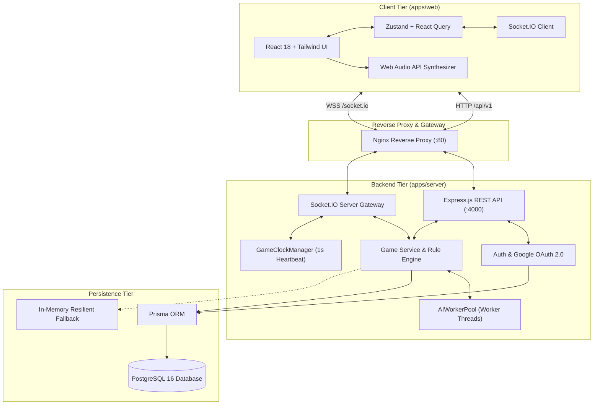
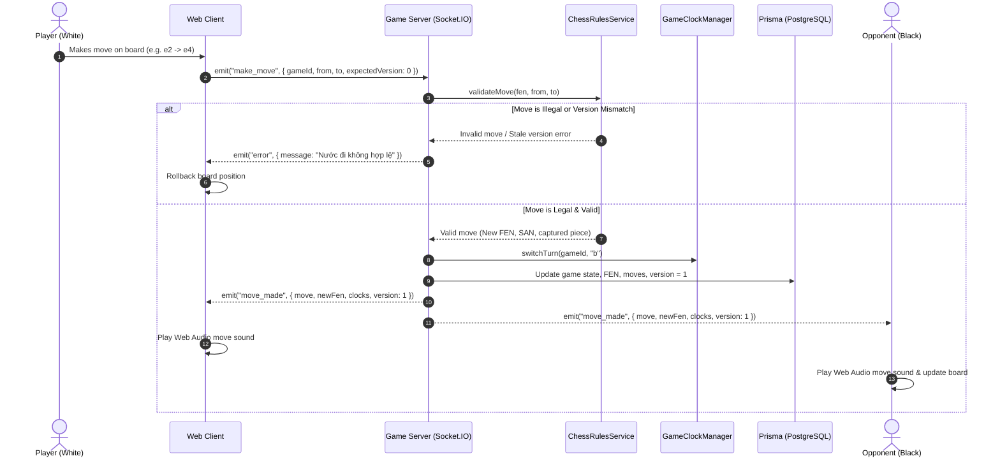

# Online Chess Platform ♟️

> **Academic Capstone Project in Software Engineering & Computer Science**  
> *Real-Time Client-Server Architecture, Authoritative Chess Rules, Google OAuth 2.0, Multi-threaded Minimax AI Engine with Alpha-Beta Pruning, and WCAG 2.2 AA Accessibility Compliance.*

[](#8-automated-testing-status)
[](LICENSE)
[](https://www.typescriptlang.org/)
[](https://react.dev/)
[](https://nodejs.org/)
[](https://www.postgresql.org/)
[](https://www.docker.com/)
[](https://tailwindcss.com/)

---

## 1. Project Overview

**Online Chess** is a production-grade, full-stack, real-time multiplayer chess web application designed and engineered with modern enterprise architectural patterns:

- **Server-Authoritative Game Logic**: All chess moves, validation, clocks, and game terminations (checkmate, stalemate, draw by 50-move rule, threefold repetition, resignation, and timeout) are authoritatively computed on the server.
- **Optimistic Concurrency & Version Guard (CAS)**: Every state transition is version-tracked with `expectedVersion`, strictly preventing race conditions, desynchronized replay, or concurrent double-move exploits.
- **Dedicated Worker Thread AI Engine (`AIWorkerPool`)**: High-depth Minimax computations are isolated into a Node.js `worker_threads` pool, guaranteeing zero event-loop blocking under high load.
- **Iterative Deepening Search (IDS) with PV & MVV-LVA Move Ordering**: Custom algorithmic chess engine featuring dynamic branch pruning, Quiescence evaluation for tactical captures, bitwise time guards (128-node cadence), and resilient in-process fallbacks.
- **Authoritative Distributed Clocks (`GameClockManager`)**: High-frequency 1-second server heartbeat loops coupled with smooth client-side linear interpolation, eliminating timer drift and latency desynchronization.
- **Dual-Mode Repository Resilience**: Fault-tolerant data access layer seamlessly alternating between PostgreSQL (Prisma ORM) and transactional in-memory fallback buffers during network partitioning.
- **Comprehensive Authentication & Security**: Salted Bcrypt hashing, dual-token JWT rotation (Access + Refresh), strict email OTP verification, and **Google OAuth 2.0 Single Sign-On (SSO)**.
- **Competitive & Social System**: Real-time matchmaking queue, private 6-character room codes, FIDE-standard Elo calculations, global leaderboards, in-game chat, and move replay viewer.
- **Accessible & Tournament-Grade UI (WCAG 2.2 AA)**: Distinctive dark tournament aesthetic adhering to `frontend-design` standards, high-contrast board themes, focus traps (`useDialogFocusTrap`), check indicators with red danger pulse, tabular numerics (`tabular-nums font-mono`), and zero-latency Web Audio API sound synthesis.
- **Administrative Portal & Telemetry**: Live system monitoring (CPU, memory, uptime, active rooms), user directory, and account status moderation (`ACTIVE` / `SUSPENDED`).

---

## 2. Technology Stack

### Frontend (`apps/web`)
- **React 18** with **TypeScript** and **Vite** (HMR and optimized code splitting into vendor chunks).
- **Tailwind CSS** with a tournament palette (`slate-900`, `board-dark`, `board-light`, `clock-amber`).
- **Zustand** for lightweight reactive authentication and UI state management.
- **Socket.IO Client** for bidirectional, low-latency WebSocket communication.
- **TanStack Query (React Query)** for server-state caching, invalidation, and synchronization.
- **react-chessboard** with customized SVG piece rendering, legal move indicator dots, and mobile touch locks (`touch-none`).
- **@react-oauth/google** for Google Identity Services integration.
- **React Hook Form & Zod** for schema validation.
- **Web Audio API** for custom procedural audio synthesis (0ms latency, zero external asset overhead).
- **Lucide React** for accessible, semantic iconography.
- **Nginx (Alpine)** as production reverse proxy handling SPA routing, WebSocket upgrades, and API proxying.

### Backend (`apps/server`)
- **Node.js (v20+ / v22+)** with **TypeScript** and **Express.js**.
- **Socket.IO** with custom room gateways, heartbeat mechanisms, and authoritative clock intervals.
- **Worker Threads (`worker_threads`)**: Dedicated thread pool executing AI search tasks in background threads.
- **PostgreSQL 16** for ACID-compliant relational persistence.
- **Prisma ORM** for type-safe schema migrations, relational integrity, and connection pooling.
- **Google Auth Library** for cryptographic verification of Google ID tokens.
- **Nodemailer** for transactional emails (verification tokens and account security notices).
- **bcryptjs & jsonwebtoken** for salted password hashing and JWT access/refresh token lifecycle.
- **Pino & pino-pretty** for high-performance structured JSON logging.
- **Vitest & Supertest** for automated unit, integration, and E2E test suites.

### Custom Chess AI Engine (`apps/server/src/modules/ai`)
- **Minimax Search** with **Alpha-Beta Pruning**.
- **Iterative Deepening Search (IDS)**: Depth-by-depth exploration with Principal Variation (PV) move prioritization.
- **Dynamic Move Ordering**: MVV-LVA (Most Valuable Victim - Least Valuable Attacker), promotion checks, and tactical check extensions.
- **Quiescence Search**: Solves the horizon effect by evaluating tactical exchanges until a quiet position is reached.
- **Centipawn Evaluation**: Material balance, Piece-Square Tables (PST), king safety metrics, and pawn structure evaluation.
- **Configurable Difficulties**:
  - `EASY`: Depth 1 with 35% controlled stochastic variance.
  - `MEDIUM`: Depth 3 with full move ordering and mate-in-1 detection.
  - `HARD`: Depth 4 with tactical depth extension and full positional evaluation.

---

## 3. System Architecture & Concurrency Model



### Authoritative Move Execution Sequence



---

## 4. Monorepo Structure

```
online-chess/
├── apps/
│   ├── web/                     # React 18 + Vite frontend
│   │   ├── nginx.conf           # Production Nginx reverse proxy configuration
│   │   ├── Dockerfile           # Multi-stage production build (Node -> Nginx)
│   │   ├── src/
│   │   │   ├── app/             # App shell, Navbar, Routes
│   │   │   ├── features/        # Feature modules: auth, lobby, game, ai, leaderboard, profile, replay, admin
│   │   │   ├── hooks/           # useDialogFocusTrap, useSoundEffect, useWindowSize
│   │   │   ├── lib/             # chessUtils, confetti, api client
│   │   │   ├── services/        # Axios API client & Socket.IO singleton
│   │   │   └── stores/          # Zustand authentication store
│   │   ├── tests/               # Web client tests (authStore, chessState, chessUtils)
│   │   └── package.json
│   └── server/                  # Node.js + Express + Socket.IO backend
│       ├── Dockerfile           # Multi-stage production Node.js container
│       ├── prisma/              # Prisma PostgreSQL schema, migrations, seed data
│       ├── src/
│       │   ├── config/          # Dynamic CORS, environment variables, Pino logger
│       │   ├── database/        # Prisma client & connection resilience
│       │   ├── middleware/      # JWT auth, role guard, error handler, Zod validator
│       │   ├── modules/         # auth, users, rooms, matchmaking, games, chess, ai, ratings, admin, mail
│       │   └── sockets/         # Socket.IO game gateway, room manager & clock loops
│       ├── tests/               # Server Vitest test suites (65 passing tests)
│       └── package.json
├── packages/
│   └── shared/                  # Shared TypeScript types, Zod schemas, constants, socket contracts
│       ├── src/
│       │   ├── constants/       # Chess FEN, time controls, ELO configs, AI settings
│       │   ├── schemas/         # Zod schemas for auth, rooms, moves, chat
│       │   └── types/           # User, Game, Move, Room, Socket payloads
│       └── package.json
├── docs/                        # Complete academic capstone documentation
│   ├── requirements.md          # Functional & non-functional requirements (SRS)
│   ├── architecture.md          # System architecture, class & sequence diagrams
│   ├── database-design.md       # PostgreSQL schema, ERD, tables & indexes
│   ├── api-specification.md     # Versioned REST API documentation (/api/v1)
│   ├── socket-events.md         # WebSocket event contracts & payloads
│   ├── chess-engine.md          # Minimax & Alpha-Beta algorithm specification
│   ├── testing.md               # Automated testing report & verification cases
│   ├── deployment.md            # AWS EC2, Let's Encrypt SSL, Docker & Nginx deployment guide
│   ├── project-analysis.md      # Comprehensive architecture & security analysis
│   └── use-cases.md             # Use case diagram & formal specifications
├── BAO_CAO_VA_PHAN_TICH_DU_AN.md # Comprehensive engineering report & technical analysis
├── docker-compose.yml           # PostgreSQL 16 + Server + Web Docker setup
├── .env.example                 # Template for environment configuration
├── package.json                 # Monorepo npm workspaces configuration
├── LICENSE                      # MIT Open-Source License
└── README.md                    # Project documentation
```

---

## 5. Quick Start Guide

### Prerequisites
- **Node.js** $\ge$ 20.x (LTS recommended)
- **npm** $\ge$ 10.x
- **PostgreSQL** $\ge$ 16 (or run via Docker)

### 1. Installation
Clone the repository and install all workspace dependencies:
```bash
git clone https://github.com/myne4713-debug/ChessProject.git
cd ChessProject
npm install
```

### 2. Environment Configuration
Copy `.env.example` to `.env` in the project root:
```bash
cp .env.example .env
```
Ensure database connection parameters and JWT secrets are populated.

### 3. Generate Database Client & Run Migrations
```bash
# Generate Prisma Client
npm run db:generate

# Apply database migrations
npm run db:migrate

# (Optional) Seed initial data (includes admin account: admin / AdminSecurePass123!)
npm run db:seed
```

### 4. Build Monorepo Packages
```bash
npm run build
```

### 5. Run Automated Tests
Execute the entire test suite across all packages (75 tests):
```bash
npm test
```

### 6. Start Development Servers
```bash
# Terminal 1: Backend Server (runs on http://localhost:4000)
npm run dev:server

# Terminal 2: Web Client (runs on http://localhost:5173)
npm run dev:web
```
Open **`http://localhost:5173`** in your browser.

---

## 6. Docker Production Deployment

Deploy the entire fullstack platform (Database + Backend + Web Reverse Proxy) with a single command:

```bash
# 1. Build and start containers in detached mode
docker compose up -d --build

# 2. Apply database migrations inside the server container
docker compose exec server npx prisma migrate deploy

# 3. Seed default administrator account
docker compose exec server npx prisma db seed
```

### Container Endpoints:
- **Web Application**: `http://localhost:80` (or `https://<your-domain>`)
- **Backend API & Healthcheck**: `http://localhost:4000/api/v1/health`
- **PostgreSQL Database**: `127.0.0.1:5432`

For advanced production deployment with **AWS EC2**, **DuckDNS**, **Let's Encrypt SSL (Certbot)**, and **Google Cloud OAuth Console**, refer to the detailed [Deployment & Operations Guide](docs/deployment.md).

---

## 7. Live Demonstration Walkthrough

### Scenario A: Real-Time Human-vs-Human Multiplayer
1. Open two separate browser tabs or private windows:
   - Window 1: Register player `grandmaster_1` (starts at 1200 Elo).
   - Window 2: Register player `grandmaster_2` (starts at 1200 Elo).
2. In Window 1, navigate to **Sảnh chờ (Lobby)** and click **Tạo Phòng Mới** (select 5m Blitz or 10m Rapid).
3. In Window 2, join using the 6-character room code or click the public room listing.
4. The server assigns colors, starts the clock loops, and redirects both players to `/game/:id`.
5. Play moves (`1. e4 e5`, etc.):
   - State updates bidirectionally via WebSockets.
   - Authoritative clocks count down smoothly on both sides.
   - Illegal moves are rejected by the server.
   - Real-time in-game chat delivers messages instantly.
6. Upon checkmate, timeout, or resignation:
   - Celebration animations fire.
   - Elo rating adjustments are calculated using FIDE Elo formulas and saved to the database.

### Scenario B: Challenging the Custom Multi-threaded AI
1. Navigate to **Đấu với AI** (`/ai`).
2. Select difficulty level (`Dễ`, `Trung bình`, `Khó`) and side (`Trắng` / `Đen`).
3. Click **Bắt Đầu Ván Mới**.
4. Play against the AI:
   - Heavy calculations run inside dedicated `worker_threads` without freezing the server.
   - Real-time diagnostics display search depth, visited nodes, pruned branches, execution time (ms), and centipawn position evaluation.

### Scenario C: Match Replay & History
1. Navigate to **Lịch sử đấu** (`/history`).
2. Select any finished match to open the Replay Viewer (`/replay/:id`).
3. Use the stepper controls (`|<<`, `<`, `>`, `>>`) to analyze moves, review SAN notation, and reconstruct previous board states.

### Scenario D: Platform Administration
1. Log in with administrator credentials (`admin` / `AdminSecurePass123!`).
2. Navigate to **Quản trị viên** (`/admin`).
3. View platform metrics, total users, active games, server memory/CPU usage, and moderate user accounts (`ACTIVE` / `SUSPENDED`).

---

## 8. Automated Testing Status

The project maintains an automated test pyramid implemented with **Vitest** and **Supertest** with **100% passing results (75/75 tests)** across 10 test suites:

| Subsystem | Test Suite | Passing Tests | Scope & Key Behaviors Validated |
| :--- | :--- | :---: | :--- |
| **Backend** | `tests/auth.test.ts` | 20 | User registration, password hashing, JWT validation, Google OAuth verification, email confirmation, profile updates. |
| **Backend** | `tests/game.test.ts` | 15 | Room creation, matchmaking, authoritative move execution, resignations, draw offers, FIDE Elo calculations. |
| **Backend** | `tests/chessRules.test.ts` | 8 | Turn enforcement, check/checkmate detection, castling legality, en passant, promotion validation. |
| **Backend** | `tests/phase2.test.ts` | 8 | Advanced authorization rules, rate limiting, token refresh cycles, account status enforcement. |
| **Backend** | `tests/ai.test.ts` | 6 | Minimax search depth, alpha-beta cutoffs, MVV-LVA move ordering, tactical evaluation benchmarks. |
| **Backend** | `tests/health.test.ts` | 4 | Healthcheck endpoints, database ping, system uptime, route fallback. |
| **Backend** | `tests/admin.test.ts` | 4 | Administrative access controls, telemetry aggregation, account moderation. |
| **Frontend** | `tests/authStore.test.ts` | 4 | Zustand authentication state, token storage, login/logout synchronization. |
| **Frontend** | `tests/chessState.test.ts` | 3 | Client-side board state sync, move parsing, legal drag-and-drop validation. |
| **Frontend** | `tests/chessUtils.test.ts` | 3 | King in check square locator (`findKingSquare`), check indicators, move highlight helpers. |

**Total**: `75 passed (75)` across 10 test files.

---

## 9. Academic Documentation Index

Comprehensive documentation is provided in the repository:
- [Báo cáo và Phân tích Toàn diện Dự án (Comprehensive Report)](BAO_CAO_VA_PHAN_TICH_DU_AN.md)
- [Requirements Specification (SRS)](docs/requirements.md)
- [System Architecture & Diagrams](docs/architecture.md)
- [Database Design & ERD](docs/database-design.md)
- [REST API Specification](docs/api-specification.md)
- [Socket.IO Event Contracts](docs/socket-events.md)
- [Chess AI Engine Specification](docs/chess-engine.md)
- [Automated Testing Report](docs/testing.md)
- [Deployment & Operations Guide (EC2, SSL, Docker)](docs/deployment.md)
- [Comprehensive Project & Security Analysis](docs/project-analysis.md)
- [Use Case Specifications](docs/use-cases.md)

---

## 10. License & Attribution

This project is licensed under the **MIT License** — see the [LICENSE](LICENSE) file for details.

Developed as an academic capstone project demonstrating Software Engineering, Distributed Systems, Real-Time Networking, and Artificial Intelligence concepts.

All rights reserved © 2026 Online Chess Contributors.
